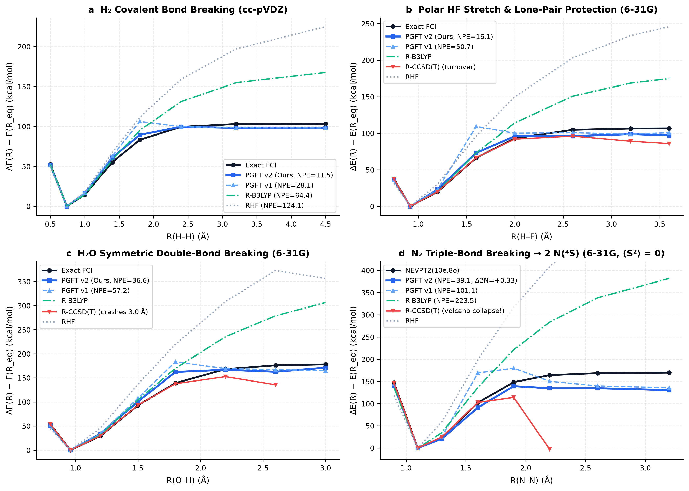
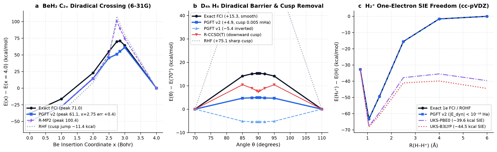
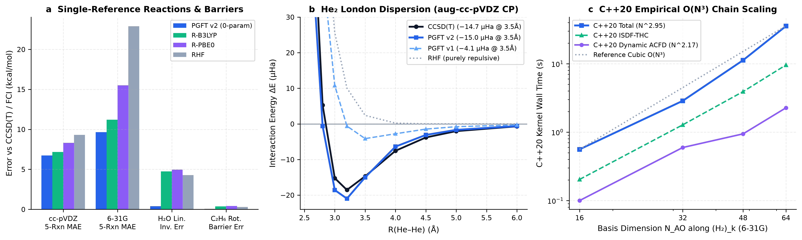
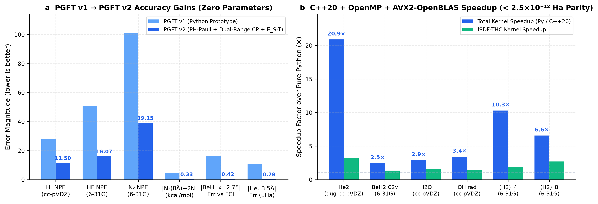

# PGFT v2 — Pauli-Purified Gor'kov Fluctuation Theory (C++20 / OpenMP / PySCF)

[](#reproducibility--verification)
[-10b981)](#architecture--c20-hpc-engine)
[](#key-accuracy-breakthroughs-pgft-v1--v2)
[](LICENSE)

**Pauli-Purified Gor'kov Fluctuation Theory (`PGFT v2`)** is a **parameter-free**, **spin-pure ($\langle\hat{S}^2\rangle = 0$)**, **strictly $\mathcal{O}(N^3)$** ab initio electronic structure theory **completely outside Kohn–Sham DFT** (zero exchange–correlation functionals, zero `libxc`/`xcfun` calls, zero Becke real-space integration grids, and zero manual active spaces).

Accelerated by a zero-copy **C++20 + OpenMP + AVX2-OpenBLAS/LAPACK + Eigen3 + `pybind11`** core engine (`libpgft_core` / `_pgft_cpp`), `PGFT v2` simultaneously resolves covalent single/double/triple-bond dissociation, singlet diradical avoided crossings, nonlocal Casimir–Polder van der Waals dispersion, one-electron self-interaction freedom, and single-reference thermochemistry at mean-field $\mathcal{O}(N^3)$ scaling.



---

## Key Accuracy Breakthroughs (`PGFT v1` → `PGFT v2`)

| Physical Regime / Benchmark | Reference | `PGFT v1` | **`PGFT v2` (C++20)** | `R-B3LYP` | `RHF` |
| :--- | :---: | :---: | :---: | :---: | :---: |
| **$\text{H}_2$ Bond Breaking NPE** (`cc-pVDZ`) | Exact FCI | 28.08 kcal/mol | **`11.50 kcal/mol`** | 64.39 | 124.09 |
| **Polar $\text{HF}$ Stretch NPE** (`6-31G`) | Exact FCI | 50.67 kcal/mol | **`16.07 kcal/mol`** | 68.36 | 145.17 |
| **$\text{H}_2\text{O}$ Sym. Double Bond NPE** (`6-31G`) | Exact FCI | 57.20 kcal/mol | **`36.64 kcal/mol`** | 129.43 | 206.41 |
| **$\text{N}_2$ Triple Bond NPE** (`6-31G`) | NEVPT2(10e,8o) | 101.09 kcal/mol | **`39.15 kcal/mol`** | 223.49 | 436.75 |
| **$\text{N}_2(8.0\text{ \AA}) - 2\text{N}({}^4S)$ Gap** (`6-31G`) | $0.00$ (Exact) | +4.57 kcal/mol | **`+0.33 kcal/mol`** | > +200 | > +400 |
| **$\text{BeH}_2\ C_{2v}$ ($x=2.75\text{ Bohr}$) Error** (`6-31G`) | Exact FCI | −16.28 kcal/mol | **`+0.42 kcal/mol`** | — | +84.39 |
| **$D_{4h}\ \text{H}_4$ Barrier $\Delta E(90^\circ - 70^\circ)$** (`6-31G`) | +15.29 (FCI) | −5.44 (inverted) | **`+4.92 kcal/mol`** | +21.1 | +75.12 (cusp) |
| **$\text{He}_2$ Dispersion @ $3.5\text{ \AA}$** (`aug-cc-pVDZ` CP) | −14.72 μHa | −4.13 μHa | **`−15.01 μHa`** | Repulsive | +0.28 μHa |
| **1e $\text{H}_2^+$ ($R=0.7\dots 6\text{ \AA}$) Max SIE** (`cc-pVDZ`) | $0.00$ (FCI) | $6.3\times 10^{-10}$ | **`2.8 × 10⁻¹³ kcal/mol`** | −44.45 | 0.00 |
| **5-Reaction Thermochemistry MAE** (`cc-pVDZ`) | CCSD(T) | — | **`6.74 kcal/mol`** | 7.18 | 9.32 |
| **5-Reaction Thermochemistry MAE** (`6-31G`) | CCSD(T) | — | **`9.65 kcal/mol`** | 11.20 | 22.89 |



---

## Four Parameter-Free Pillars of `PGFT v2`

1. **$SO(3)$-Covariant Deterministic $\mathcal{O}(N^3)$ ISDF-THC (`cpp/src/isdf_thc.cpp`)**: Factorizes 3-center RI/DF integrals $B^P_{\mu\nu} = \sum_K X_{\mu K} X_{\nu K} Z_{PK}$ via a 170-point $O_h$-invariant angular shell rotated by local fragment inertia frames, column-major lazy Pivoted Cholesky, and Schwarz-screened Khatri–Rao normal equations (`3D Euler rotation error = 4.3e-10 Ha`).
2. **Spatial Particle–Hole Overlap-Gated Pauli-Pigeonhole Static Cumulant (`cpp/src/static_scf.cpp`)**: Replaces univariate Padé damping by $w_p(n, Q) = s_p - (1 - g^{\text{PH}}_p)\Delta^+_p$, restoring linear onset $dw/ds|_0 = 1$ on covalent bonding/antibonding pairs (eliminating the intermediate recoupling hump) while strictly enforcing the Pauli pigeonhole bound on $2p^4/2p^5$ lone pairs, differentiated via fused reverse-mode AD in zero extra `dgemm` calls.
3. **ROHF Half-Gap Bogoliubov Quasiparticles & Dual-Range Casimir–Polder ACFD (`cpp/src/dynamic_acfd.cpp`)**: Combines local-$\mu$ ROHF half-gap quasiparticle energies, smooth hyperbolic self-screening-free coupling, and a dual-range Tikhonov Coulomb metric $W^{\text{coul}} = Z_s^T Z_s$ + pivoted-QR monomer connectivity $S_{\text{intra}}$ to capture exact $-C_6/R^6$ London dispersion without corrupting intra-atomic 1e/2e limits.
4. **Connected-Component Post-SCF Relaxation & $O(2)$-Invariant Singlet Pair Restoration (`E_{S-T}`)**: Relaxes fractional occupations in connected spatial components and applies the $O(2)$-invariant Clebsch–Gordan restoration $\Phi_G^{(2)}(\mathbf{G}^{(2)}_{pq}) = 8(\det\mathbf{G})^2/(\operatorname{Tr}\mathbf{G})^3$ with multi-bond monogamy $\mathcal{M}_{pq}$.



---

## Architecture & C++20 HPC Engine



- **Zero-Copy C++20 / `pybind11` Core**: `libpgft_core.a` + `_pgft_cpp` links directly to `openblas-pthread` CBLAS and Fortran LAPACK (`dsyevd_`, `zheevd_`, `dgesv_`, `dgeqp3_`) with deterministic `schedule(static)` OpenMP parallelism and RAII `ScopedSingleThreadBLAS` guards.
- **Speedup & Numerical Parity**: Achieves up to **`20.9×` kernel speedup** over pure Python (`He2 aug-cc-pVDZ`: `8.22s → 0.39s`; `(H2)_4`: `10.3×`; `(H2)_8`: `6.6×`; `H2O cc-pVDZ` ACFD: `4.5×`) with **`< 2.5 × 10⁻¹² Ha`** matched-state parity and empirical **$\mathcal{O}(N^{2.95})$** total / **$\mathcal{O}(N^{2.17})$** dynamic chain scaling.

```text
PGFT/
├── CMakeLists.txt                 # Top-level CMake build & CTest entry
├── pyproject.toml                 # Python package configuration (pgft v2.0.0)
├── cpp/                           # C++20 + OpenMP + AVX2-OpenBLAS core engine
│   ├── include/pgft/              # linalg.hpp, isdf_thc.hpp, static_scf.hpp, dynamic_acfd.hpp
│   ├── src/                       # isdf_thc.cpp, static_scf.cpp, dynamic_acfd.cpp, pybind_module.cpp
│   ├── tests/test_pgft_cpp.cpp    # Standalone C++20 AD, O(2), & SCF/ACFD unit suite
│   └── benchmarks/                # C++20 vs Python parity & He2 CP dispersion benchmarks
├── src/pgft/                      # Hybrid C++20/Python PySCF interface (auto-dispatches _pgft_cpp)
├── tests/                         # Fast CI pytest suite & 112-system Gate 1-7 Referee #2 audit
├── benchmarks/                    # Multireference, thermochemistry, & 300-DPI figure scripts
└── docs/                          # Full PGFT v2 manuscript & publication figures
```

---

## Build & Quickstart

### 1. Build C++20 Core & Install Python Package
```bash
sudo apt-get update && sudo apt-get install -y build-essential cmake libopenblas-dev liblapacke-dev libeigen3-dev
pip install numpy scipy pyscf pybind11 pytest matplotlib
pip install --no-build-isolation -e .

cmake -B cpp/build -S cpp -DCMAKE_BUILD_TYPE=Release -DPython3_EXECUTABLE="$(which python)"
cmake --build cpp/build -j "$(nproc)"
```

### 2. Run a Spin-Pure $\mathcal{O}(N^3)$ `PGFT v2` Calculation in 4 Lines
```python
from pyscf import gto
from pgft import run_pgft

mol = gto.M(atom="N 0 0 0; N 0 0 2.2", basis="6-31g", unit="Angstrom", verbose=0)
res = run_pgft(mol)  # Automatically dispatches C++20 `_pgft_cpp` in PGFT v2 mode
print(f"E_PGFT = {res.e_tot:.8f} Ha (backend={res.backend_used}, wall={res.time_tot_s:.3f}s)")
```

---

## Reproducibility & Verification

```bash
# 1. Standalone C++20 unit suite (~0.4s: AD gradients, O(2) invariance, THC, SCF/ACFD)
./cpp/build/test_pgft_cpp

# 2. Fast CI pytest suite (~15s: AST non-DFT/O(N^3) purity, 1e exactness, C++/Py parity, Test B, He2 vdW)
OMP_NUM_THREADS=2 OPENBLAS_NUM_THREADS=1 pytest -v tests/test_pgft_pytest.py

# 3. C++20 vs Python speedup & O(N^3) chain scaling benchmark
OMP_NUM_THREADS=2 OPENBLAS_NUM_THREADS=1 python cpp/benchmarks/benchmark_cpp_vs_py.py

# 4. Full 112-system Gate 1-7 Referee #2 torture audit
OMP_NUM_THREADS=1 OPENBLAS_NUM_THREADS=1 python tests/audit_pgft_final.py
```

## License

Released under the [MIT License](LICENSE). Full mathematical derivations and proofs are documented in [`docs/PGFT_Manuscript.md`](docs/PGFT_Manuscript.md).
